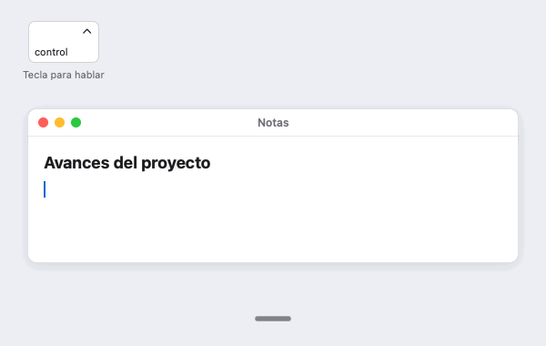
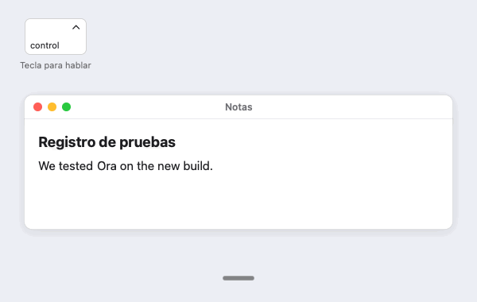
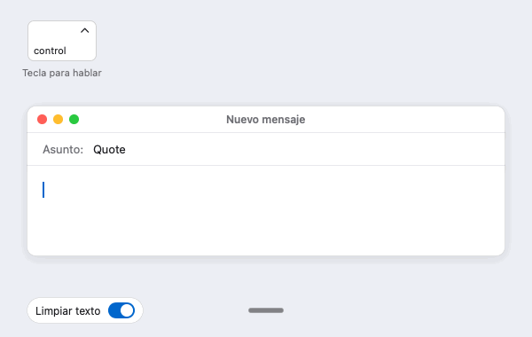
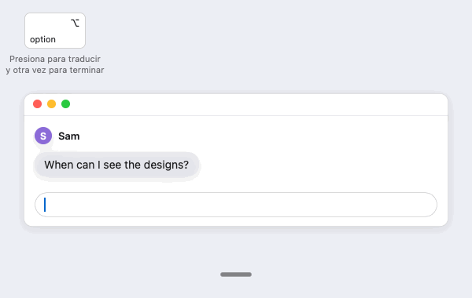
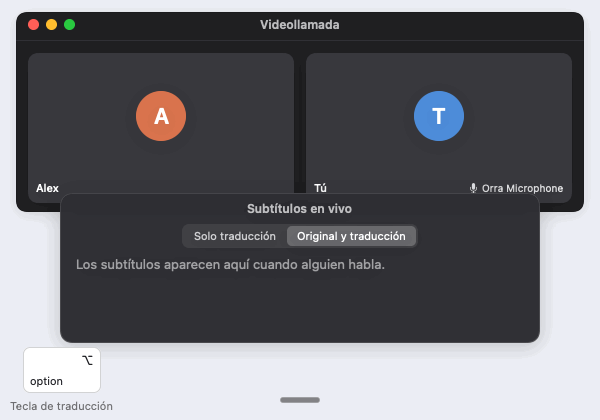
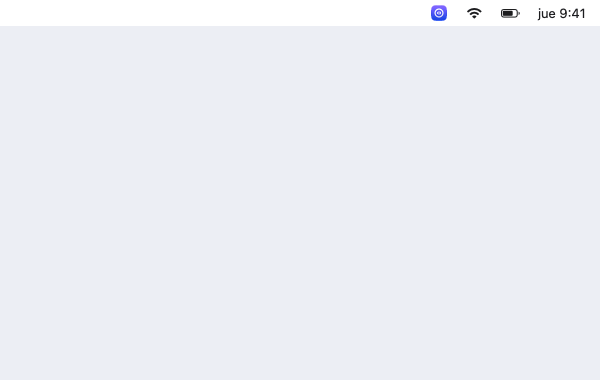

<h1 align="center">
   Orra
</h1>

  
  
  

<a href="README.md">English</a> · <a href="README.zh-CN.md">简体中文</a> · <a href="README.ja.md">日本語</a> · Español

  <strong>Dictado por voz de código abierto para la Mac.</strong> 
  Presiona una tecla, habla, vuelve a presionarla y tus palabras aparecen en la app en la que estás escribiendo. 
  Tu voz se convierte en texto en tu propia Mac, nunca en un servidor.

<h3 align="center"><a href="https://github.com/db-ol/Orra/releases/latest/download/Orra.dmg"><ins>Descargar Orra</ins></a></h3>

Para computadoras Mac con Apple Chip y macOS 15.6 o posterior. Orra es una versión preliminar. Todavía tiene detalles por pulir, y su diseño va a cambiar.

## Funciones

<table>
<tr>
<td width="50%" valign="middle">

### Dictado en cualquier app

Habla en chino (mandarín y cantonés), en inglés o en los dos mezclados en la misma oración. En Idioma de dictado, en Configuración, puedes elegir en su lugar japonés o español con inglés, en beta. El modelo Qwen3-ASR 1.7B lo transcribe en tu Mac y Orra lo pega donde está el cursor. Las muletillas como 呃, um y uh desaparecen, y los números dichos en chino, como fechas, precios y porcentajes, se escriben con cifras.

</td>
<td width="50%"></td>
</tr>
<tr>
<td width="50%" valign="middle">

### Tus palabras, como tú las escribes

Un vocabulario personal de hasta 5,000 nombres y términos, para que Orra los escriba como tú. Si activas el aprendizaje, Orra aprende de las palabras que corriges justo después de un dictado y la próxima vez las escribe bien. Con japonés o español como idioma de dictado, por ahora el aprendizaje solo funciona con oraciones en inglés.

</td>
<td width="50%"></td>
</tr>
<tr>
<td width="50%" valign="middle">

### Limpieza con un modelo local

Opcional. Un modelo de texto en tu Mac elimina las muletillas que las reglas dejan pasar y aplica las rectificaciones que haces al hablar, así que “at three, oh wait, four” queda como “at four”. Pegar texto original siempre recupera lo que dijiste. Con japonés o español como idioma de dictado, por ahora la limpieza solo funciona con oraciones en inglés.

</td>
<td width="50%"></td>
</tr>
<tr>
<td width="50%" valign="middle">

### Tecla de traducción

Opcional. Presiona una segunda tecla, habla y vuelve a presionarla. Si la configuras en Mantener presionada, mantenla presionada mientras hablas. Orra pega lo que dices traducido entre el inglés y tu idioma de dictado, chino, japonés o español, con el mismo modelo en tu Mac. Una pequeña marca indica que ese dictado se va a traducir: 译 con chino, 訳 con japonés y ⇄ con español.

</td>
<td width="50%"></td>
</tr>
<tr>
<td width="50%" valign="middle">

### Interpretación en reuniones

Para reuniones en distintos idiomas. Lee en tu idioma lo que dicen los demás y deja que te escuchen en el suyo, incluso con tu propia voz. **Subtítulos en vivo** muestra lo que reproduce la Mac, como una llamada, en forma de subtítulos traducidos en una ventana flotante. **Leer traducciones a los demás** lee en voz alta lo que dijiste con la tecla de traducción, con un modelo de síntesis de voz en tu Mac, y lo envía al dispositivo virtual Orra Microphone, para que la otra persona de la llamada escuche tus palabras en su idioma.

Novedad de la versión 0.4.0.

</td>
<td width="50%"></td>
</tr>
<tr>
<td colspan="2" valign="middle">

### Proyectos (vista previa)

Opcional, para una Mac con 16 GB de memoria o más, y una vista previa que todavía puede cambiar. Elige los buzones de Mail que lee Orra y agrega tus proyectos con sus carpetas y personas, o empieza con los proyectos que Orra sugiere, y Orra clasifica cada correo nuevo en su proyecto. Haz clic en Explicar, y el modelo local enumera lo que dice el correo, con sus fuentes en los archivos de su proyecto, y de tus otros proyectos cuando coinciden, en sus adjuntos y en correos anteriores, y las preguntas que solo tú puedes decidir. La explicación aparece en inglés. Cuando el correo necesita respuesta, sigue un borrador en el idioma del correo, chino o inglés. Un correo que Proyectos detecta en otro idioma, como el japonés, no recibe borrador. Cuando un correo te pide enviar un archivo, Proyectos muestra los archivos de las carpetas de tus proyectos que podrían ser ese. El borrador lo cambias escribiendo o con la tecla para hablar, y lo pegas en la ventana de respuesta de Mail, donde Orra puede adjuntar los archivos de las carpetas de tus proyectos que marques. Orra nunca envía, mueve ni elimina correos, y nada de lo que lee sale de tu Mac, salvo los archivos que marcas para una respuesta, que Mail puede guardar con la respuesta en los Borradores de tu cuenta en el servidor de correo antes de que la envíes.

</td>
</tr>
<tr>
<td width="50%" valign="middle">

### Actualizaciones desde la app

Orra solo busca una versión nueva después de que se lo permites, y solo la instala cuando tú lo decides. Todas las actualizaciones están firmadas.

</td>
<td width="50%"></td>
</tr>
</table>

## Instalación

- **[Descarga Orra.dmg](https://github.com/db-ol/Orra/releases/latest/download/Orra.dmg)**, la versión más reciente, ábrelo y arrastra Orra a la carpeta Aplicaciones. Las versiones anteriores y las notas de la versión están en [la página de versiones](https://github.com/db-ol/Orra/releases).
- **Orra Microphone**, opcional, para Leer traducciones a los demás: descarga [OrraMicrophone.pkg](https://github.com/db-ol/Orra/releases/download/v0.4.0/OrraMicrophone.pkg), firmado y notariado, y ábrelo para instalarlo. [Drivers/OrraMicrophone](Drivers/OrraMicrophone/README.md) (en inglés) explica cómo quitarlo o compilarlo por tu cuenta.
- Requiere una Mac con Apple Chip y macOS 15.6 o posterior, y unos 3 GB de espacio disponible en el disco, más 3.05 GB para el modelo local opcional, que limpia, traduce y explica el correo en Proyectos, y unos 2 GB para el modelo de síntesis de voz opcional de Leer traducciones a los demás. Proyectos requiere 16 GB de memoria o más.
- La app está firmada con un Developer ID y notariada por Apple, así que se abre sin advertencias.
- No está en la Mac App Store, porque el entorno aislado (sandbox) de la App Store no permite que una app detecte una tecla en otras apps ni pegue texto en ellas.

Al abrir Orra, una ventana de bienvenida te guía para descargar los modelos, permitir el acceso al micrófono y a Accesibilidad, y elegir tu tecla para hablar y cómo funciona. La [guía del usuario](docs/user-guide.es.md) explica cada función y su configuración.

## Privacidad

Orra convierte tu voz en texto en tu Mac y nunca envía tus grabaciones ni su texto a ningún lado. No tiene cuentas, ni estadísticas de uso, ni servidor propio. Solo se conecta a Internet para descargar los modelos que pides y, una vez que lo permites, para buscar actualizaciones. Las funciones que guardan algo, como Aprender de mis correcciones, Recordar mi voz y Proyectos, están desactivadas hasta que las activas.

Proyectos lee el correo a través de la app Mail de tu Mac y los archivos de las carpetas que agregas, y solo los procesa en tu Mac, con el modelo de tu Mac y, para las imágenes y las páginas escaneadas, con el reconocimiento de texto de macOS. Orra nunca se conecta por su cuenta a un servidor de correo. La app Mail sigue recibiendo tu correo como siempre.

[docs/privacy.es.md](docs/privacy.es.md) detalla qué guardan Orra y Proyectos, cuándo se conecta Orra a Internet y cómo eliminar los modelos.

## Comunidad y soporte

- **Reporta un problema.** Selecciona Reportar un problema… en el menú de Orra o [abre un issue en GitHub](https://github.com/db-ol/Orra/issues/new/choose). Por favor, no incluyas nada privado que hayas dictado. Para un problema en Proyectos, tampoco incluyas el texto de correos, nombres, direcciones de correo ni capturas de pantalla de correos.
- **Preguntas e ideas.** Pregunta en [Discussions](https://github.com/db-ol/Orra/discussions).
- **WeChat.** Escanea el código para unirte al grupo de Orra en WeChat. 
  
- **Apoya el proyecto.** Si Orra te resulta útil, [dale una estrella en GitHub](https://github.com/db-ol/Orra).

## Para desarrolladores

El código de Orra está escrito en Swift y SwiftUI. [docs/development.md](docs/development.md) (en inglés) explica cómo compilar y probar Orra, cómo está organizado el código y cómo se publican las versiones. Lee [AGENTS.md](AGENTS.md) antes de modificar el código.

## Licencia

MIT. Consulta [LICENSE](LICENSE).
