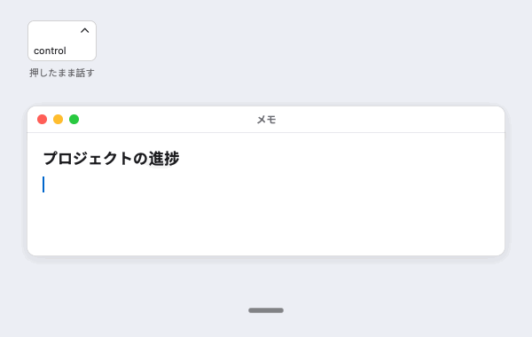
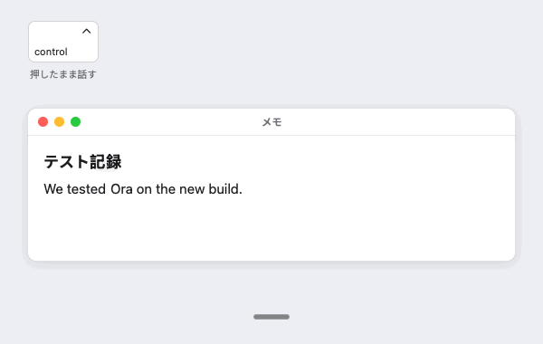
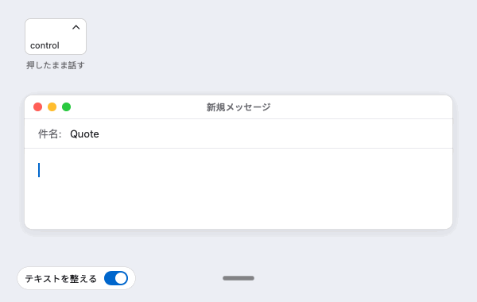
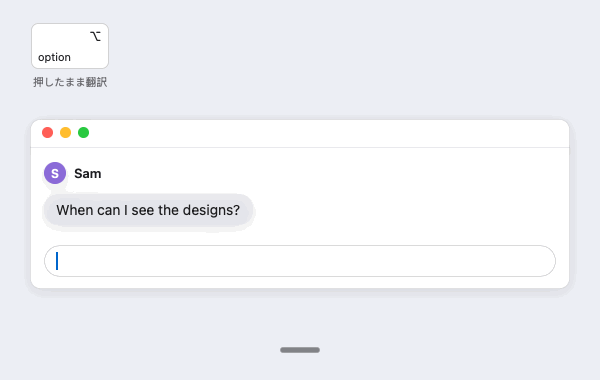
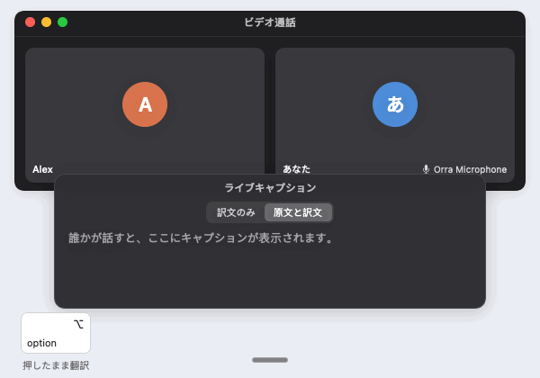

<h1 align="center">
   Orra
</h1>

  
  
  

<a href="README.md">English</a> · <a href="README.zh-CN.md">简体中文</a> · 日本語 · <a href="README.es.md">Español</a>

  <strong>Mac用のオープンソース音声入力アプリ。</strong> 
  キーを押して話し、もう一度押すと、入力中のアプリに言葉が入力されます。 
  音声はサーバではなく、お使いのMac上でテキストに変換されます。

<h3 align="center"><a href="https://github.com/db-ol/Orra/releases/latest/download/Orra.dmg"><ins>Orraをダウンロード</ins></a></h3>

Appleシリコンを搭載し、macOS 15.6以降を実行しているMacに対応しています。Orraは早期プレビュー版です。粗削りな部分があること、デザインが今後変わることをご了承ください。

## 機能

<table>
<tr>
<td width="50%" valign="middle">

### どのアプリにも音声入力

中国語（普通話と広東語）でも英語でも、1つの文の中で両方を混ぜて話しても大丈夫です。設定の“音声入力の言語”では、代わりに日本語またはスペイン語を英語と組み合わせて選ぶこともできます（ベータ版）。お使いのMac上でQwen3-ASR 1.7Bモデルが文字に起こし、Orraがカーソルの位置にペーストします。“呃”、“um”、“uh”などのフィラーは取り除かれ、日付、価格、パーセンテージなど中国語で話した数字は算用数字になります。

</td>
<td width="50%"></td>
</tr>
<tr>
<td width="50%" valign="middle">

### あなたの言葉を、あなたの表記で

名前や用語を最大5,000個まで登録できる自分専用の用語集があり、Orraはそれらをあなたの表記で書きます。学習機能をオンにすると、音声入力の直後に修正した単語からOrraが学習し、次からは正しく書きます。音声入力の言語に日本語やスペイン語を選んだ場合、学習機能は今のところ英語の文にのみ対応しています。

</td>
<td width="50%"></td>
</tr>
<tr>
<td width="50%" valign="middle">

### ローカルモデルで整文

オプションです。お使いのMac上のテキストモデルが、ルールで取り切れなかったフィラーを取り除き、話しながらの言い直しを反映します。たとえば“at three, oh wait, four”は“at four”になります。“原文をペースト”を使えば、話したとおりのテキストにいつでも戻せます。音声入力の言語に日本語やスペイン語を選んだ場合、整文は今のところ英語の文にのみ対応しています。

</td>
<td width="50%"></td>
</tr>
<tr>
<td width="50%" valign="middle">

### 翻訳キー

オプションです。もう1つのキーを押して話し、もう一度押します。キーを“押したまま”に設定した場合は、押したまま話します。Orraは同じモデルを使ってお使いのMac上で、英語と音声入力の言語（中国語、日本語、スペイン語）の間で翻訳し、訳文をペーストします。小さなバッジは、その音声入力が翻訳されることを示します。中国語では“译”、日本語では“訳”、スペイン語では“⇄”です。

</td>
<td width="50%"></td>
</tr>
<tr>
<td width="50%" valign="middle">

### 会議通訳

言語の異なる相手との会議のための機能です。相手の話はあなたの言語で読めて、あなたの話は相手の言語で聞いてもらえます。あなた自身の声で届けることもできます。**ライブキャプション**は、通話などMacで再生される音声を翻訳し、フローティングウインドウにキャプションとして表示します。**翻訳を相手に読み上げる**は、翻訳キーで話した内容をお使いのMac上の音声合成モデルで読み上げ、Orra Microphone仮想デバイスに送ります。通話の相手には、あなたの言葉が相手の言語で聞こえます。

0.4.0の新機能です。

</td>
<td width="50%"></td>
</tr>
<tr>
<td colspan="2" valign="middle">

### プロジェクト（プレビュー）

オプション機能で、メモリが16 GB以上のMacが必要です。プレビュー版のため、今後変わることがあります。Orraが読み取る“メール”のメールボックスを選び、プロジェクトをそのフォルダや関係者と一緒に追加するか、Orraが提案するプロジェクトから始めると、Orraが新しいメールをそれぞれのプロジェクトに振り分けます。“説明する”をクリックすると、ローカルモデルがメールの要点を、プロジェクトのファイル、添付ファイル、以前のメールといった出典とともに示し、あなたにしか決められない質問も挙げます。説明は英語で表示されます。返信が必要なメールには、続けてメールの言語（中国語または英語）で返信の下書きが作成されます。ほかの言語（日本語など）と判断されたメールには、下書きは作成されません。下書きは入力するか音声入力キーで変更して、“メール”の返信ウインドウにペーストします。Orraがメールを送信、移動、削除することはなく、読み取った内容がMacの外に出ることもありません。

</td>
</tr>
<tr>
<td width="50%" valign="middle">

### アプリ内でアップデート

Orraが新しいバージョンを確認するのは許可したあとだけで、インストールするのも選択したときだけです。アップデートにはすべて署名が付いています。

</td>
<td width="50%"></td>
</tr>
</table>

## インストール

- **[Orra.dmgをダウンロード](https://github.com/db-ol/Orra/releases/latest/download/Orra.dmg)**（最新バージョン）。開いて、Orraを“アプリケーション”フォルダにドラッグします。以前のバージョンとリリースノートは[リリースページ](https://github.com/db-ol/Orra/releases)にあります。
- **Orra Microphone**（オプション、“翻訳を相手に読み上げる”用）: 署名と公証を受けた[OrraMicrophone.pkg](https://github.com/db-ol/Orra/releases/download/v0.4.0/OrraMicrophone.pkg)をダウンロードし、開いてインストールします。削除する方法や自分でビルドする方法は[Drivers/OrraMicrophone](Drivers/OrraMicrophone/README.md)（英語）で説明しています。
- Appleシリコンを搭載し、macOS 15.6以降を実行しているMacと、約3 GBのディスクの空き容量が必要です。整文、翻訳、“プロジェクト”でのメールの説明に使うオプションのローカルモデルにはさらに3.05 GB、“翻訳を相手に読み上げる”で使うオプションの音声合成モデルには約2 GBが必要です。“プロジェクト”には16 GB以上のメモリが必要です。
- Developer IDで署名され、Appleの公証を受けているため、警告なしで開けます。
- Mac App Storeでは配布していません。App Storeのサンドボックスでは、ほかのアプリでのキー操作を検知したり、ほかのアプリにペーストしたりできないためです。

Orraを開くと、ようこそウインドウの案内に沿って、モデルのダウンロード、マイクとアクセシビリティの許可、音声入力キーとその動作の選択を進められます。各機能とその設定については[ユーザガイド](docs/user-guide.ja.md)で説明しています。

## プライバシー

Orraはお使いのMac上で音声をテキストに変換し、録音やそのテキストをどこにも送信しません。アカウントも、利用状況の解析も、独自のサーバもありません。インターネットに接続するのは、指示されたモデルをダウンロードするときと、許可を受けたあとでアップデートを確認するときだけです。“自分の修正から学習”、“自分の声を記憶”、“プロジェクト”など、何かを保存する機能は、オンにするまでオフのままです。

“プロジェクト”は、お使いのMacの“メール”アプリを通じてメールを読み取り、追加したフォルダ内のファイルを読み取って、Mac上だけで処理します。使うのはMac上のモデルと、画像とスキャンしたページについてはmacOSのテキスト認識です。Orra自身がメールサーバに接続することはありません。“メール”アプリはこれまでどおりメールを受信します。

Orraと“プロジェクト”が保存するもの、Orraがインターネットに接続するタイミング、モデルの削除方法は[docs/privacy.ja.md](docs/privacy.ja.md)にまとめています。

## コミュニティとサポート

- **問題の報告。** Orraメニューで“問題を報告…”を選択するか、[GitHubでIssueを作成](https://github.com/db-ol/Orra/issues/new/choose)してください。音声入力した個人的な内容は含めないでください。“プロジェクト”の問題では、メールの本文、名前、メールアドレス、メールのスクリーンショットも含めないでください。
- **質問とアイデア。** [Discussions](https://github.com/db-ol/Orra/discussions)で質問してください。
- **WeChat。** スキャンするとOrraのWeChatグループに参加できます。 
  
- **応援する。** Orraが役に立ったら、[GitHubでスターを付けて](https://github.com/db-ol/Orra)ください。

## 開発者向け

OrraはSwiftとSwiftUIで書かれています。ビルドとテストの方法、コードの構成、リリースの作り方は[docs/development.md](docs/development.md)（英語）で説明しています。コードを変更する前に[AGENTS.md](AGENTS.md)を読んでください。

## ライセンス

MITライセンスです。[LICENSE](LICENSE)を参照してください。
