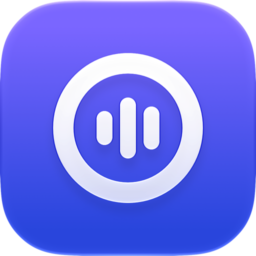
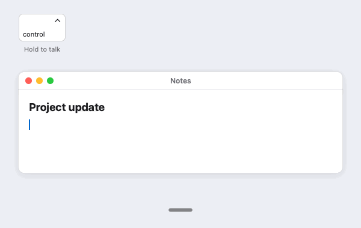
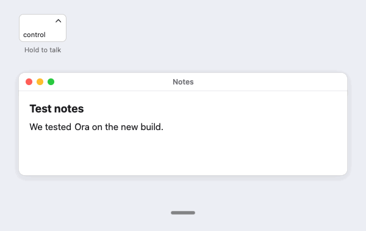
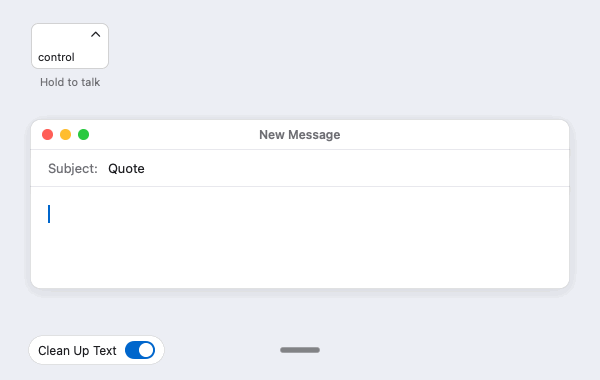
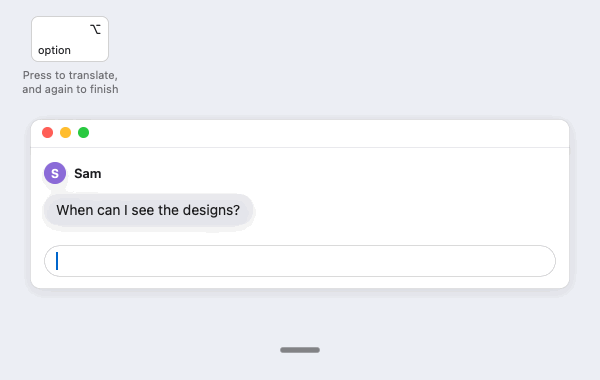
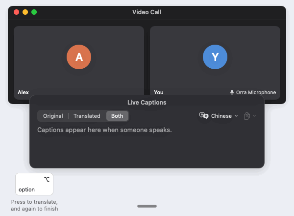
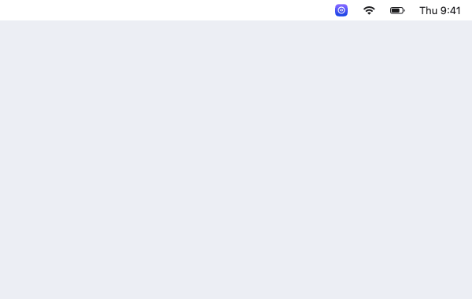

<h1 align="center">
   Orra
</h1>

  
  
  
  
  
  
  

English · <a href="README.zh-CN.md">简体中文</a>

  <strong>Open source voice input for the Mac.</strong> 
  Hold a key, speak, let go, and the words land in the app you are typing in. 
  Your speech is turned into text on your own Mac, never on a server.

<h3 align="center"><a href="https://github.com/db-ol/Orra/releases/latest/download/Orra.dmg"><ins>Download Orra</ins></a></h3>

For Macs with Apple Silicon and macOS 15.6 or later. Orra is an early preview. Expect rough edges, and expect the design to change.

## Features

<table>
<tr>
<td width="50%" valign="middle">

### Dictation into any app

Speak Chinese, English, or both mixed in one sentence. The Qwen3-ASR 1.7B model writes it down on your Mac and Orra pastes it where your cursor is. Fillers such as 呃, um and uh go away, and numbers spoken in Chinese, such as dates, prices and percentages, become digits.

</td>
<td width="50%"></td>
</tr>
<tr>
<td width="50%" valign="middle">

### Your words, your spelling

A personal vocabulary of up to 5,000 names and terms, so Orra writes them your way. If you turn it on, Orra learns from the words you fix right after a dictation and writes them right the next time.

</td>
<td width="50%"></td>
</tr>
<tr>
<td width="50%" valign="middle">

### Cleanup with a local model

Optional. A text model on your Mac removes the fillers the rules leave and applies spoken self corrections, so “at three, oh wait, four” becomes “at four”. Paste Original Text always brings back what you said.

</td>
<td width="50%"></td>
</tr>
<tr>
<td width="50%" valign="middle">

### Translation key

Optional. Hold a second key and Orra pastes what you say translated between Chinese and English, with the same model on your Mac. A small 译 badge shows that this dictation will be translated.

</td>
<td width="50%"></td>
</tr>
<tr>
<td width="50%" valign="middle">

### Meeting Interpretation

For meetings across languages. Read what others say in your language, and let them hear you in theirs, even in your own voice. **Live Captions** shows what the Mac plays, such as a call, as translated captions in a floating window. **Speak Translations to Others** speaks what you said with the translation key in a voice model on your Mac, into the Orra Microphone virtual device, so the other side of the call hears your words in their language.

New in 0.4.0.

</td>
<td width="50%"></td>
</tr>
<tr>
<td width="50%" valign="middle">

### Updates inside the app

Orra checks for a new version only after you allow it, and installs one only when you choose to. Every update is signed.

</td>
<td width="50%"></td>
</tr>
</table>

The animations are drawn to show how Orra works. They are not screen recordings. [Tools/readme-media](Tools/readme-media) makes them.

## Download

Download [Orra.dmg](https://github.com/db-ol/Orra/releases/latest/download/Orra.dmg), the newest version, open it, and drag Orra to Applications. Older versions and the release notes are on [the releases page](https://github.com/db-ol/Orra/releases).

- Needs a Mac with Apple Silicon and macOS 15.6 or later, and about 3 GB of free disk space, plus 2.8 GB for the optional local model, which cleans up and translates, and about 2 GB for the optional voice model of Speak Translations to Others.
- Signed with a Developer ID and notarized by Apple, so it opens without a warning.
- Not in the Mac App Store, because the App Store's sandbox does not let an app notice a key in other apps or paste into them.

## Getting started

1. Open Orra. A welcome window, with a small guide that says what to do next, walks you through four steps. At the top, pick Orra's language, English or 简体中文, or keep the Mac's. The window switches to it right away, and you can change it later in Settings, General. The first three steps make Orra ready, and the last one is up to you:
   - **Download the models**, once. On a Mac with 16 GB of memory or more, Download Models (5.52 GB) fetches the speech model, 2.47 GB, and then a second local model that cleans up what you say, 3.05 GB, behind one progress bar, and turns cleanup on. You can dictate as soon as the speech model is in place. The cleanup model needs about 4 GB of memory while it runs, and Clean Up Text in Settings, General turns cleanup off. On a smaller Mac this step downloads only the speech model, and you can turn on cleanup later in Settings, General.
   - **Allow the microphone.**
   - **Allow Accessibility**, which Orra needs to notice the talk key and to paste the text. Once System Settings opens, a small card beside it shows in an animation where to turn Orra on. The card goes away when Orra is on. If you denied the microphone before, Open Microphone Settings… in the microphone step shows a similar card beside System Settings.
   - **Choose your talk key** by pressing it. On a Mac's own keyboard, fn (Globe) at the bottom left is comfortable while your right hand is on the mouse. On an external keyboard, right Control works best, because some, such as the Logitech MX Keys, never send fn. If you switch between the two, add the other key as a second talk key in Settings, see Keys below.
2. Hold the talk key, right Control unless you pick another, and speak. Let go, and the text appears where your cursor is. While you speak, white bars in a small dark capsule at the bottom of the screen move with your voice (unless you turn this off in Settings), and macOS shows its orange microphone indicator in the menu bar.
3. Orra lives in the menu bar and the Dock. Its menu and Settings hold everything else. Once Orra is ready, the welcome window shows Try next: cleanup, translation and Meeting Interpretation, with a button that opens Settings for each one that is not on yet.

## Using Orra

- **Keys.** Settings, General, Keys holds the talk key and the translation key. Click a key's field (or Change…) and press what you want: fn (Globe), the left or right Control, Option or Command key, or a combination such as Control and Option held together, or Shift Command D. Keyboards label keys differently, so the field shows the Mac name and symbol and, for Option and Command, what a Windows layout keyboard prints there, such as “⌥ Right Option (Alt)” or “⌘ Right Command (Windows key)”. Talk Key in the menu shows the keys and opens Settings to change them. Each key has a mode: Hold (the default), Press to start and stop, or Double press. A left Control, Option or Command key starts only after you hold it alone for a moment, so shortcuts keep working. Shift, Caps Lock and keys that type cannot be a key on their own, and shortcuts that macOS or most apps use, such as Command C or Control Space, cannot be chosen. The field says why and which keys work. The regular key of a combination never reaches the app in front, and pressed alone it types as usual. Second key, right under the talk key, adds one more single key that works just like the talk key, in its mode, such as right Control beside fn. That helps when you switch to an external keyboard that never sends fn. With fn as the talk key and no second key, Orra offers one once, when an external keyboard is connected. If an earlier version had several talk keys on, Orra keeps one: fn first, then right Control, then the other right hand keys, then the left hand ones.
- **Hands free.** With a key in Hold, press it twice quickly, then let go and keep talking. The indicator says which key finishes. Press it once to paste, or press Escape to cancel. A recording stops after 1 minute. Settings, General, Dictation turns double press off.
- **Vocabulary.** In Settings, Vocabulary, add the words and names you use. Orra gives the speech model the 200 you added or used most recently with every dictation, since a longer list helps less per word and slows every dictation. On test speech this raised the share of such terms written correctly from about 84% to 99% in Chinese and from 83% to 96% in English, and listed words were almost never inserted when nobody said them. The list holds up to 5,000 words, a cap only against runaway data. The table shows for each word whether you added it or Orra learned it, how Orra misheard it, and when you last used it.
- **Learning from your corrections.** Turn on “Learn from my corrections” in Settings, General, Dictation. When you fix a misheard word right after a dictation, Orra adds your spelling to the vocabulary and shows a notice with Undo. That includes a space taken out or put in, such as read me to readme. When you fix one Chinese character of a name, such as 林悦 to 霖悦, Orra asks instead and offers its guess of the whole word to edit. Later, where the speech model still writes the misheard spelling, Orra writes your word, as long as learning is on and the word is in your vocabulary. A misheard spelling made only of ordinary words, such as there for their, is never replaced, and putting the misheard spelling back stops the replacement. A word you remove is learned again the next time you fix it, while a word you undid is not. Learning works in apps that let macOS read their text, such as Notes, Mail and Safari. In other apps, copy the word and choose the add item in Orra's menu.
- **Fillers and numbers.** Before it pastes, Orra removes fillers that only fill a pause, such as 呃, 额, um and uh, and keeps words that carry meaning, such as 好啊, 吧 and 那个. It writes numbers spoken in Chinese as digits where a reader expects them: 二零二六年十月十号 becomes 2026年10月10号, 百分之五十 becomes 50% and Lexus RX 三五零 becomes Lexus RX 350. Small counts such as 三本书, rough numbers and idioms stay in words. Settings, General, Clean Up Text, Options… turns each off.
- **Cleanup with a local model.** For a new user on a Mac with 16 GB of memory or more, Download Models in the welcome window also downloads its model, Qwen3.5 4B, 3.05 GB, and turns cleanup on. Otherwise it is off until you turn on Clean Up Text in Settings, General, and Orra then asks before it downloads the model. Clean Up Text also turns it off. Orra runs the model on your Mac after the filler and number rules. It removes fillers the rules leave, such as 那个 and 就是说 used as fillers, and applies spoken self corrections, such as 三点，哦不对，四点 or “Monday, I mean Tuesday”. Loaded, it needs about 4 GB of memory. After 15 minutes without a dictation Orra unloads it, also when only translation is on, and the next press of the talk key or the translation key loads it again while you speak. On an M5 Pro it added 0.6 to 1 second to a short dictation and 3 to 6 seconds to one of 400 Chinese characters, and slower Macs take longer. Dictations longer than 400 characters are pasted without cleanup. Orra holds back a cleanup that looks like an answer or a carried out request, or that adds words or numbers, and pastes the text without it, as it does when the model takes too long. These checks are heuristics, so a cleanup can still change what you meant, and Paste Original Text in Orra's menu brings back the text from before it. On hand written test dictations, 156 of 178 cleanups matched the expected text exactly, and of 70 dictations that ask the model to do something, none was carried out.
- **Translation.** Off until you turn on Translation in Settings, General, Features. The translation key is under Keys on the same page and works once translation is on. It uses the cleanup model, also while cleanup is off, and asks to download it first when it is not on your Mac. Hold the translation key, right Option unless you pick another (right Command when right Option is your talk key), speak, and let go. Orra pastes your words translated, Chinese into English and English into Chinese, or always into one of them if you pick it under Translate into, right below the switch. Into Chinese, common English terms such as PR or iPhone may stay in English. The translation key waits 0.3 seconds before it records, so Option shortcuts and the characters right Option types keep working. Press it twice quickly to translate hands free. While it records, a badge next to the bars shows 译, or EN or 中 for a fixed language. Picking one key's key for the other swaps the two, and Settings says so. Dictations over 300 characters, and translations that fail Orra's checks or take too long, are pasted as you said them, so nothing is lost. Paste Original Text brings back the text from before the translation, Copy Last Dictation copies the translation, and Orra never learns corrections from a translated paste. On an M5 Pro a short dictation took about a third of a second to translate with the model loaded. After the model was unloaded, a very short hold may wait for it to load.
- **Meeting Interpretation.** New in 0.4.0. Its switches are in Settings, General, Meeting Interpretation and in Orra's menu.
  - **Live Captions** is off at every launch. It captures the sound the Mac plays, never the microphone, and shows each sentence in a floating window, translated by the local model, either the translation only or the original and the translation, as you choose in the window or in Settings. About a second after someone starts to talk, their first words show in small grey type and grow while they speak. When the sentence ends, its final text takes their place and the translation follows. macOS asks once to allow Orra under Screen & System Audio Recording. Without the local model the window shows what was said until you download it. Closing the window turns captions off. Captions stay in memory only and are gone when you turn them off.
  - **Speak Translations to Others** needs Translation on. A translated dictation of the translation key is also spoken by a voice model on your Mac, Qwen3-TTS, about 2 GB to download, into an output device: the one you pick, or Orra Microphone when it is installed, never the speakers on its own. Choose Orra Microphone as the microphone in the call app, and the other side hears the translation. Without Orra Microphone, pick a device such as a loopback device a call app can use as its microphone. Orra speaks one translation after another and waits while you dictate. By default the translation is pasted too. With a voice sample, each sentence is checked before it plays. To have it speak in your voice, click Record… beside Voice sample and read a short script aloud, about 10 seconds, or import an audio file there. Orra keeps the sample in memory until it quits. With Remember my voice on, which is off until you turn it on, Orra saves the sample's audio, never the words, in ~/Library/Application Support/io.github.db-ol.Orra/Voice, left out of backups, until you remove it or turn the switch off. After Orra restarts, it loads the sample once Speak Translations to Others is on. Use only your own voice, and tell the other side they hear a synthesized voice. Orra Microphone is a separate audio driver, not part of Orra.dmg. Download [OrraMicrophone.pkg](https://github.com/db-ol/Orra/releases/download/v0.4.0/OrraMicrophone.pkg) from the 0.4.0 release, signed and notarized, and open it to install. [Drivers/OrraMicrophone](Drivers/OrraMicrophone/README.md) explains how to remove it or build it yourself.
- **Microphone.** Orra records from the system's default input unless you choose another under Microphone. With the lid of a MacBook closed, its own microphone is off, so choose another one, such as a webcam's.
- **Sounds, on screen hint and Dock icon.** Settings, General, Dictation turns the sounds off and sets the on screen hint: Always shows the bars while you dictate and a small bar while Orra is ready, Only while dictating leaves out the small bar, and Off shows neither. Show Orra in the Dock under System turns the Dock icon off.
- **Language.** Orra's menus and windows are in English and Simplified Chinese, following your Mac. To choose another, use Language in the welcome window, or Interface language in Settings, General, System, and restart Orra. After a choice in the welcome window, Orra restarts on its own when you click Done, unless Settings or another Orra window is still open or a model is still downloading.
- **Updates.** Choose Check for Updates in the menu, or let Orra check by itself in Settings, About, which also shows the version.
- **Reporting a problem.** Choose Report a Problem… in Orra's menu and describe what happened. Continue on GitHub opens a new issue with your text, Orra's version, macOS and your Mac model filled in. GitHub needs a free account, and issues there are public. Orra also writes a diagnostic report for you to drag into the issue.

## Privacy

Orra turns your speech into text on your Mac and never sends your recordings or their text anywhere. It has no account, no analytics and no server of its own. The text it pastes stays on this Mac's clipboard, so Universal Clipboard does not offer it to your other devices.

**Learning from your corrections** is off until you turn it on. While it is on, Orra reads the text of the field it just pasted into, through macOS Accessibility, once a second for up to 3 minutes after each paste, and only while you are in that field. It reads at most 20,000 characters, keeps the text in memory during those minutes only, and never writes it anywhere. It never reads password fields or an app with secure input on. It keeps only the word pairs, such as 奥拉 and Orra, with how often and when each was seen, in ~/Library/Application Support/io.github.db-ol.Orra/corrections.json, and forgets a pair seen once after a week. Runs of three or more digits, such as codes, amounts and years, are never kept. Orra changes dictated text only where a kept pair's misheard spelling appears. Forget Learned Corrections in Settings deletes all pairs.

**Meeting Interpretation** keeps captions and the words said in the voice sample in memory only. It keeps the voice sample in memory too, unless you turn on Remember my voice, which is off until you do. It never logs text or audio.

**Orra uses the internet for model downloads you ask for and for update checks only.**

- **The speech model**, only after you choose Download Speech Model, or Download Models in the welcome window: six files, 2.47 GB, from Hugging Face (huggingface.co). If Hugging Face cannot be reached, for example from mainland China, Orra tries ModelScope (modelscope.cn) and then hf-mirror.com, which carry the same files. Orra checks the size and SHA-256 hash of every file against values in its source code, so a mirror cannot change the model. The files live in ~/Library/Application Support/io.github.db-ol.Orra/Models, left out of Time Machine backups.
- **The cleanup model**, only after you click Download Models or Download Cleanup Model in the welcome window, which offers them to a new user on a Mac with 16 GB of memory or more or while cleanup is on, or turn on Clean Up Text or Translation in Settings and agree to its download: four files of mlx-community/Qwen3.5-4B-4bit, 3.05 GB, from the same servers, checked the same way, into its own folder under Models.
- **The voice model**, only after you start its download for Speak Translations to Others: Qwen3-TTS, about 2 GB, from Hugging Face or hf-mirror.com, checked the same way.
- **Update checks**, only after you allow them. At its second launch Orra asks whether to check automatically, and Settings, About has the choice. A check reads https://github.com/db-ol/Orra/releases/latest/download/appcast.xml about once a day. Orra installs an update only when you choose it, each time, and only when the update and its feed are signed with the project's update key.

The models run on your Mac and never go online. Launching Orra never connects to the network until you allowed update checks. Like any download, these services see your IP address, and an update check also shows Orra's version and, as every web request does, your preferred languages. Orra sends no account, token or cookie, and nothing else about your Mac. [docs/model-download.md](docs/model-download.md) describes the servers and the checks in detail.

**Report a Problem** writes a text file on your Mac with Orra's version, settings and permissions, the Mac's model, chip, memory, macOS version and languages, the microphone's name, Orra's own log from the last hour and its crash reports from the last 7 days. It holds no dictated text, audio, clipboard, vocabulary or learned words. Your home folder, account name, full name and computer name are taken out. Orra sends nothing itself. It opens the GitHub page in your browser, and the file reaches GitHub only if you attach it.

To remove the models, quit Orra and delete the Models folder above. To remove only the cleanup model, turn cleanup and translation off first and delete its folder, Qwen3.5-4B-4bit-0e7ffd5c, inside it. If ~/Library/Caches/qwen3-speech holds a copy from another app, delete that too, or Orra installs the model again from it.

## Feedback and help

- **Found a problem?** Choose Report a Problem… in Orra's menu, or [open an issue on GitHub](https://github.com/db-ol/Orra/issues/new/choose). Please leave out anything private you dictated.
- **Have a question or an idea?** Ask in [Discussions](https://github.com/db-ol/Orra/discussions).

## For developers

Orra is written in Swift and SwiftUI. [docs/development.md](docs/development.md) explains how to build and test it, how the code is organized, and how releases are made. Read [AGENTS.md](AGENTS.md) before changing the code.

## License

MIT. See [LICENSE](LICENSE).
