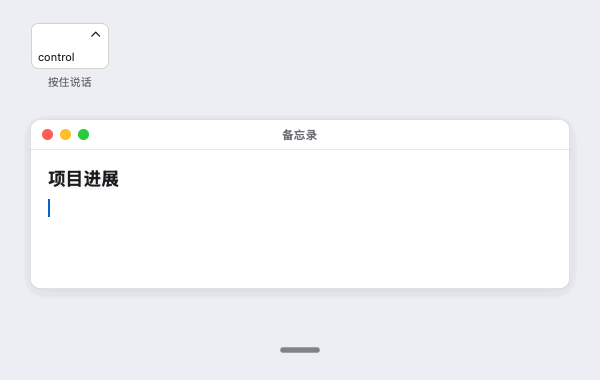
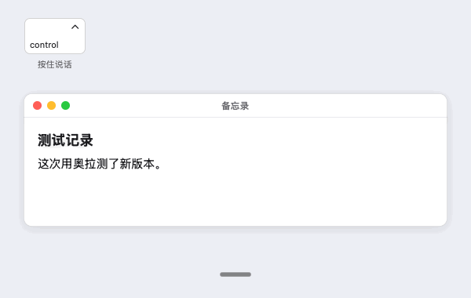
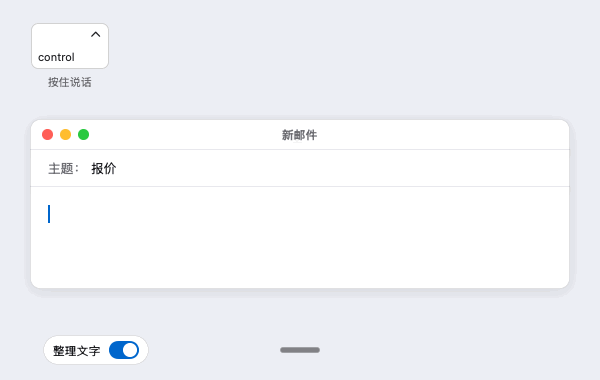
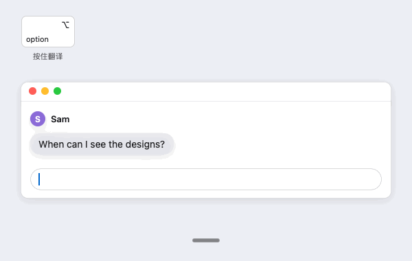
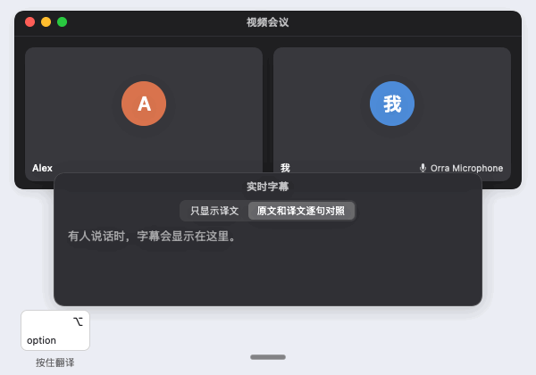

<h1 align="center">
   Orra
</h1>

  
  
  
  
  
  
  

<a href="README.md">English</a> · 简体中文

  <strong>开源的 Mac 语音输入 App。</strong> 
  按住一个键说话，松开后，文字就会出现在你正在输入的 App 里。 
  语音在你自己的 Mac 上转成文字，从不经过服务器。

<h3 align="center"><a href="https://github.com/db-ol/Orra/releases/latest/download/Orra.dmg"><ins>下载 Orra</ins></a></h3>

适用于搭载 Apple 芯片、macOS 15.6 或更高版本的 Mac。Orra 目前是早期预览版，难免有不完善的地方，设计也还会调整。

## 功能

<table>
<tr>
<td width="50%" valign="middle">

### 在任何 App 里听写

说中文、英文，或者一句话里中英混说。Qwen3-ASR 1.7B 模型在你的 Mac 上把它写成文字，Orra 再粘贴到光标所在的位置。“呃”“um”“uh”这类语气词会去掉，说出来的中文数字，比如日期、价格和百分比，会写成阿拉伯数字。

</td>
<td width="50%"></td>
</tr>
<tr>
<td width="50%" valign="middle">

### 你的词，你的写法

个人词库最多可以放 5000 个名字和术语，Orra 会按你的写法输出。打开学习功能后，你在听写后改正的词，Orra 会记住，下次就写对。

</td>
<td width="50%"></td>
</tr>
<tr>
<td width="50%" valign="middle">

### 用本地模型整理文字

可选功能。你 Mac 上的文字模型会去掉规则漏掉的语气词，并按你说出口的更正改好内容，比如“三点，哦不对，四点”会写成“四点”。用“粘贴原文”随时可以找回你说的原话。

</td>
<td width="50%"></td>
</tr>
<tr>
<td width="50%" valign="middle">

### 翻译键

可选功能。按住第二个键说话，Orra 会用同一个模型在你的 Mac 上把中文翻译成英文、英文翻译成中文后粘贴。小小的“译”字标记表示这次听写会被翻译。

</td>
<td width="50%"></td>
</tr>
<tr>
<td width="50%" valign="middle">

### 会议同传

适用于两种语言的会议。**实时字幕**把 Mac 播放的声音（比如通话）翻译成字幕，显示在一个浮动窗口里。**为对方朗读译文**用你 Mac 上的语音合成模型，把你用翻译键说的话读出来，送进 Orra Microphone 虚拟设备，通话另一方就能听到你说的话的译文。

尚未包含在已发布的版本中。

</td>
<td width="50%"></td>
</tr>
<tr>
<td width="50%" valign="middle">

### 在 App 里更新

只有你允许后，Orra 才会检查新版本，也只在你选择后才安装。每个更新都经过签名。

</td>
<td width="50%"></td>
</tr>
</table>

这些动画是为了说明 Orra 怎么用而绘制的，不是录屏。它们由 [Tools/readme-media](Tools/readme-media) 生成。

## 下载

下载最新版本的 [Orra.dmg](https://github.com/db-ol/Orra/releases/latest/download/Orra.dmg)，打开后把 Orra 拖进“应用程序”。旧版本和更新说明在[版本发布页面](https://github.com/db-ol/Orra/releases)。

- 需要搭载 Apple 芯片、macOS 15.6 或更高版本的 Mac，以及大约 3 GB 的可用空间。可选的本地模型（用来整理和翻译）另需 2.8 GB，“为对方朗读译文”可选的语音合成模型另需约 2 GB。
- 使用 Developer ID 签名并经过苹果公证，打开时不会出现安全警告。
- 不在 Mac App Store 上架，因为 App Store 的沙盒不允许 App 在其他 App 里监听按键或粘贴文字。

## 开始使用

1. 打开 Orra，欢迎窗口里有个小向导，会告诉你下一步做什么，带你完成五步。先在窗口顶部选择 Orra 的语言：English、简体中文，或跟随 Mac 系统。窗口会立即换成这种语言，之后也可以在“设置 → 通用”里更改。第二到第四步让 Orra 可以使用，其他两步可以按需选择：
   - **整理你说的文字。** 选择是否让 Orra 再用一个本地模型整理你说的话，模型 3.05 GB，运行时约占 4 GB 内存。内存 16 GB 及以上的 Mac 默认打开，内存更小的 Mac 默认关闭。
   - **下载语音模型**，2.47 GB，只需一次。打开整理文字时，整理模型会紧接着下载，共用一个进度条。语音模型装好后就可以听写。
   - **允许使用麦克风。**
   - **允许辅助功能**，Orra 需要它来识别说话键和粘贴文字。窗口里有一段小动画，演示在系统设置里打开 Orra 的位置。
   - **选择说话键**，按一下你想用的键就行。用 Mac 自带的键盘时，左下角的 fn（地球仪）键在右手用鼠标时很顺手。用外接键盘时，右侧 Control 键最合适，因为有些外接键盘（比如 Logitech MX Keys）的 fn 键信号根本传不到 Mac。
2. 按住说话键（默认是右侧 Control 键，可以更换）说话，松开后文字会出现在光标所在的位置。说话时，屏幕底部的深色小胶囊里有一排白色音量条随你的声音跳动（可以在设置里关掉），菜单栏里会出现 macOS 的橙色麦克风标志。
3. Orra 在菜单栏和程序坞里，其他功能都在它的菜单和设置里。

## 使用说明

- **按键。** 说话键和翻译键都在“设置 → 通用 → 按键”里。点按键的输入框（或“更改…”），再按你想用的键：fn（地球仪）键，左侧或右侧的 Control、Option、Command 键，或者组合键，比如同时按住 Control 和 Option，或者 Shift Command D。不同键盘上同一个键的叫法不一样，所以输入框会显示 Mac 上的名称和符号，Option 和 Command 键还会注明 Windows 布局键盘上印的名称，比如“⌥ 右侧 Option 键（Alt）”“⌘ 右侧 Command 键（Windows 键）”。菜单里的“说话键”会显示当前的键，并能打开设置来更改。每个键都可以选用法：“按住”（默认）、“按一下开始，再按一下结束”或“连按两下”。左侧的 Control、Option、Command 键要单独按住片刻才开始录音，所以快捷键照常可用。Shift 键、大写锁定键和会输入文字的键不能单独作为按键，macOS 或大多数 App 用到的快捷键，比如 Command C 或 Control Space，也不能选。输入框会说明原因，以及可以用哪些键。组合键里的普通键不会输入到前台的 App，单按它照常打字。如果旧版本里同时开了几个说话键，Orra 会保留一个：优先 fn 键，其次右侧 Control 键，然后是其他右侧的键，最后是左侧的键。
- **免手持模式。** 按键用“按住”时，快速连按两下，松开后继续说。屏幕底部的指示条会提示按哪个键结束，按一下就会粘贴，按 Esc 键则取消。每次最多录 1 分钟。可以在“设置 → 通用 → 听写”里关闭连按两下。
- **个人词库。** 在“设置 → 个人词库”里添加你常用的词和名字。每次听写，Orra 会把你最近添加或用过的 200 个词提供给语音模型，因为列表越长，每个词的帮助越小，每次听写也越慢。在测试语音上，这些词的正确率中文从约 84% 提高到 99%，英文从 83% 提高到 96%，而且没说到的词几乎不会被凭空加进来。词库最多可以放 5000 个词，这个上限只是为了防止数据失控。表格里显示每个词是你添加的还是 Orra 学到的、Orra 曾把它听成什么，以及你上次用到它的时间。
- **从你的修改中学习。** 在“设置 → 通用 → 听写”里打开“从我的修改中学习”。听写后你马上改正了一个听错的词，Orra 会把你的写法加入个人词库，并弹出提示，你可以撤销。去掉或加上单词之间的空格也算，比如把 read me 改成 readme。如果你只改了名字里的一个汉字，比如把“林悦”改成“霖悦”，Orra 会先询问你，并给出它猜的完整词语，你可以修改后再添加。之后的听写里，如果语音模型还是写成听错的样子，Orra 会换成你的写法，前提是学习开着、这个词还在个人词库里。只由普通词组成的听错写法（比如把 there 改成 their）从不替换。把听错的写法改回去，就不再替换。从个人词库删掉的词，下次再改正时会重新学到，点过“撤销”的词则不会。学习在 macOS 能读取文字的 App 里有效，比如备忘录、邮件和 Safari。在其他 App 里，可以拷贝这个词，再从 Orra 的菜单里添加。
- **语气词和数字。** 粘贴之前，Orra 会去掉只用来停顿的语气词，比如“呃”“额”“um”“uh”，有意义的词会保留，比如“好啊”“吧”“那个”。它还会在读者期待阿拉伯数字的地方把中文数字写成数字：“二零二六年十月十号”写成“2026年10月10号”，“百分之五十”写成“50%”，“Lexus RX 三五零”写成“Lexus RX 350”。“三本书”这样的小数目、约数和成语保持原样。两项都可以在“设置 → 通用 → 整理文字 → 选项…”里关闭。
- **用本地模型整理文字。** 内存 16 GB 及以上的 Mac，欢迎窗口里的整理开关默认打开，内存更小的 Mac 默认关闭。之后可以在“设置 → 通用”里打开或关闭“整理文字”。Orra 会先询问是否下载一个 3.05 GB 的模型（Qwen3.5 4B），然后在语气词和数字规则之后，在你的 Mac 上运行它。它会去掉规则漏掉的语气词，比如当作停顿用的“那个”“就是说”，并按你说出口的更正改好内容，比如“三点，哦不对，四点”或“Monday, I mean Tuesday”。模型加载后约占 4 GB 内存。15 分钟没有听写时，Orra 会把它从内存中卸载，只打开翻译时也一样，下次按下说话键或翻译键时，它会在你说话的同时重新加载。在 M5 Pro 上，短的听写多花 0.6 到 1 秒，400 个汉字的听写多花 3 到 6 秒，较慢的 Mac 会更久。超过 400 个字符的听写不整理，直接粘贴。如果整理结果看起来像是在回答问题或执行请求，或者加了词或数字，Orra 会放弃这次整理，粘贴未经整理的文字，模型用时太久时也一样。这些检查是经验规则，整理仍可能改变你的原意，这时可以用 Orra 菜单里的“粘贴原文”找回整理之前的文字。在手写的测试听写上，178 条整理中有 156 条与预期完全一致。在 70 条要求模型做事的听写上，没有一条被执行。
- **翻译。** 默认关闭，在“设置 → 通用 → 功能”里打开“翻译”。翻译键在同一页的“按键”里，打开翻译后才能使用。它使用整理模型，即使整理文字关闭也能用，会先询问是否下载。按住翻译键（默认是右侧 Option 键，可以更换，说话键是右侧 Option 键时默认是右侧 Command 键）说话，松开后 Orra 会粘贴译文：中文翻译成英文，英文翻译成中文，也可以在“翻译”开关正下方的“翻译成”里固定翻译成其中一种。翻译成中文时，PR、iPhone 这类常用英文词可能保留英文。翻译键要按住 0.3 秒才开始录音，所以 Option 快捷键和右侧 Option 键输入的字符照常可用。快速连按两下翻译键，就能免手持翻译。录音时，音量条旁边会显示一个小标记：“译”，固定语言时显示“EN”或“中”。如果把说话键选作翻译键，或者反过来，两个键会互换，设置里会说明。超过 300 个字符的听写，以及没通过 Orra 检查或用时太长的译文，都会按你说的原话粘贴，所以你说的话不会丢。“粘贴原文”可以找回翻译之前的文字，“拷贝上次听写”拷贝的是译文，Orra 也不会从翻译后粘贴的文字中学习更正。在 M5 Pro 上，模型载入后，翻译一条短的听写大约需要三分之一秒。模型卸载后，按住时间很短的听写可能要等它加载完。
- **会议同传。** 尚未包含在已发布的版本中。开关在“设置 → 通用 → 会议同传”和 Orra 的菜单里。
  - **实时字幕**每次启动 Orra 时都是关闭的。它捕获 Mac 播放的声音，从不使用麦克风，并在一个浮动窗口里逐句显示由本地模型翻译的字幕，可以只显示译文，也可以原文和译文逐句对照。macOS 会询问一次，请在“录屏与系统录音”中允许 Orra。没有本地模型时，窗口先显示原话，直到你下载模型。关闭窗口就会关闭字幕。字幕只保存在内存中，关闭后就消失。
  - **为对方朗读译文**需要先打开“翻译”。用翻译键说的话翻译后，还会由你 Mac 上的语音合成模型 Qwen3-TTS（约 2 GB，需要下载）读出来，送到一个输出设备：你选的设备，或者已安装时的 Orra Microphone，从不会自己送到扬声器。在通话 App 里把 Orra Microphone 选作麦克风，通话另一方就能听到译文。没有 Orra Microphone 时，可以选一个通话 App 能当作麦克风使用的设备，比如回环设备。Orra 会一条接一条地朗读译文，你听写时会先等待。默认也会粘贴译文，每句话播放前都会先检查。你可以选一段自己声音的短录音作为声音样本。Orra 只把它保存在内存中，从不存盘。请只用你自己的声音，并告诉对方他们听到的是合成的声音。Orra Microphone 是一个单独的音频驱动，见 [Drivers/OrraMicrophone](Drivers/OrraMicrophone/README.md)（英文）。
- **麦克风。** Orra 默认使用系统的输入设备，也可以在“麦克风”里选择别的。MacBook 合上盖子时内置麦克风会关闭，这时请选择其他麦克风，比如摄像头上的。
- **提示音、屏幕提示和程序坞图标。** 在“设置 → 通用 → 听写”里可以关闭提示音，并选择屏幕提示：“始终显示”会在听写时显示音量条，在 Orra 待命时显示小横条，“仅在听写时显示”不显示小横条，“不显示”则两者都不显示。程序坞图标在“设置 → 通用 → 系统”里关闭。
- **界面语言。** Orra 的菜单和窗口有英文和简体中文，默认跟随你的 Mac。要换成另一种，在欢迎窗口的“语言”或“设置 → 通用 → 系统”的“界面语言”里选择，再重新启动 Orra。在欢迎窗口里选择后，点按“完成”时 Orra 会自动重新启动，除非“设置”或 Orra 的其他窗口还开着。
- **更新。** 在菜单里选择“检查更新…”，或者在“设置 → 关于”里让 Orra 自动检查，那里也显示版本。
- **报告问题。** 在 Orra 的菜单里选择“报告问题…”，写下发生了什么，再点“在 GitHub 上继续”。浏览器会打开一个新问题，你写的内容、Orra 版本、macOS 版本和 Mac 型号都已填好。需要一个免费的 GitHub 账号，问题会公开显示。Orra 还会生成一份诊断报告，你可以把它拖进问题页面。

## 隐私

Orra 在你的 Mac 上把语音转成文字，从不把录音或文字发送到任何地方。它没有账号、没有统计，也没有自己的服务器。粘贴的文字只留在这台 Mac 的剪贴板上，所以“通用剪贴板”不会把它同步到你的其他设备。

**从你的修改中学习**默认关闭。打开后，每次粘贴后的 3 分钟内，只要你还在那个输入框里，Orra 会通过 macOS 辅助功能每秒读取一次它刚粘贴进去的那个输入框的文字。它最多读取 20,000 个字符，文字只在这几分钟里保存在内存中，从不写到任何地方。它从不读取密码框，也不读取开启了“安全输入”的 App。它只保存词对，比如“奥拉”和“Orra”，以及每对出现的次数和时间，存放在 ~/Library/Application Support/io.github.db-ol.Orra/corrections.json，只出现过一次的词对一周后会被删除。连续三位以上的数字，比如验证码、金额和年份，从不保存。Orra 只在出现已保存词对里听错的写法时修改听写出来的文字。在设置里点“清除学到的修改”会删除所有词对。

**会议同传**的字幕、声音样本和样本里说的话都只保存在内存中，从不把文字或音频写进日志。

**Orra 只在下载你要求的模型和检查更新时联网。**

- **语音模型**，只在你选择“下载语音模型”之后：六个文件，共 2.47 GB，从 Hugging Face（huggingface.co）下载。如果连不上 Hugging Face，比如在中国大陆，Orra 会依次尝试 ModelScope（modelscope.cn）和 hf-mirror.com，它们提供相同的文件。Orra 会用写在源代码里的数值核对每个文件的大小和 SHA-256 校验值，所以镜像站无法篡改模型。文件存放在 ~/Library/Application Support/io.github.db-ol.Orra/Models，不会被时间机器备份。
- **整理模型**，只在你同意下载之后，也就是在欢迎窗口里打开了整理，或在设置里打开了“整理文字”或“翻译”：mlx-community/Qwen3.5-4B-4bit 的四个文件，共 3.05 GB，从同样的服务器下载，用同样的方式核对，存放在 Models 里它自己的文件夹中。
- **语音合成模型**，只在你为“为对方朗读译文”开始下载之后：Qwen3-TTS，约 2 GB，从 Hugging Face 或 hf-mirror.com 下载，用同样的方式核对。
- **检查更新**，只在你允许之后。Orra 第二次启动时会问你是否自动检查，也可以在“设置 → 关于”里更改。检查时，Orra 大约每天读取一次 https://github.com/db-ol/Orra/releases/latest/download/appcast.xml。每次更新都要你同意后才会安装，而且只安装用本项目更新密钥签名的更新和更新清单。

模型都在你的 Mac 上运行，本身从不联网。在你允许检查更新之前，启动 Orra 从不联网。和所有下载一样，这些服务能看到你的 IP 地址。检查更新时还会看到 Orra 的版本号，以及和所有网页请求一样带上的偏好语言。Orra 不发送账号、令牌或 Cookie，也不发送任何其他关于你的 Mac 的信息。服务器和核对方式的详情见 [docs/model-download.md](docs/model-download.md)（英文）。

**报告问题**会在你的 Mac 上生成一个文本文件，包括 Orra 的版本、设置和权限状态，Mac 的型号、芯片、内存、macOS 版本和语言，麦克风名称，Orra 最近一小时的日志，以及最近 7 天的崩溃报告。它不包含任何听写的文字、录音、剪贴板、个人词库或学到的词。你的个人文件夹路径、账户名、全名和电脑名都会被去掉。Orra 自己不发送任何东西，它只是在浏览器里打开 GitHub 页面，只有你自己附上，这个文件才会到 GitHub。

要删除模型，请先退出 Orra，再删除上面的 Models 文件夹。如果只想删除整理模型，请先关闭整理和翻译，再删除其中的 Qwen3.5-4B-4bit-0e7ffd5c 文件夹。如果 ~/Library/Caches/qwen3-speech 里有其他 App 留下的副本，也请一并删除，否则 Orra 会从那里重新安装模型。

## 反馈与帮助

- **遇到问题？** 在 Orra 的菜单里选择“报告问题…”，或者直接在 [GitHub 上提交问题](https://github.com/db-ol/Orra/issues/new/choose)。请不要附上你听写的私人内容。
- **有疑问或建议？** 欢迎在 [Discussions](https://github.com/db-ol/Orra/discussions) 提问。

## 开发者

Orra 用 Swift 和 SwiftUI 编写。[docs/development.md](docs/development.md) 介绍了如何构建和测试、代码结构以及如何发布版本（英文）。修改代码前请先阅读 [AGENTS.md](AGENTS.md)。

## 许可证

MIT，见 [LICENSE](LICENSE)。
